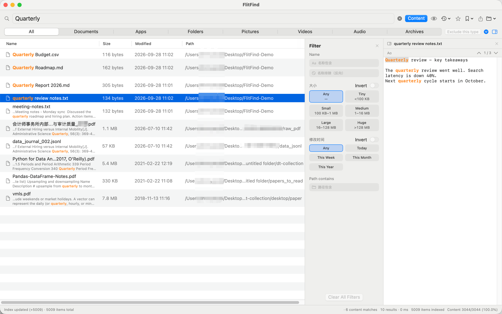

# FlitFind — Lightning File & Full-Text Search for macOS

**Type and it's there.** Instant filename results as you type — plus full-text search inside PDF, Word, Excel, PowerPoint, WPS and 100+ file formats.

## ✨ Highlights

- ⚡ **Instant as you type** — in-memory index, results with every keystroke; no Enter, no spinner
- 📄 **Full-text search** — look inside your documents, not just filenames
- 🎯 **Precise** — wildcards, regex, boolean operators, filters by extension / size / date
- 🇨🇳 **Pinyin** — find Chinese filenames by full pinyin or initials
- 🔄 **Live index** — files added, renamed or deleted are picked up instantly; never rebuild
- 🧰 **Extras** — Quick Look preview with highlighted matches, duplicate finder, CSV export, global hotkey (⌥Space), launch at login

## 📂 Supported formats (content search)

PDF · Word (doc/docx) · Excel (xls/xlsx) · PowerPoint (ppt/pptx) · WPS · RTF · OpenDocument (odt/ods/odp) · Markdown & plain text · code & config (100+ extensions: Swift, Python, Java, JS, HTML, JSON, YAML, CSV, logs…)

## 🔒 Privacy

FlitFind is 100% local. No network access, no analytics, no upload — your files never leave your Mac. Due to App Store sandboxing, FlitFind searches only folders you explicitly grant access to (grants persist across launches).

## 🚀 Getting started

1. Launch FlitFind
2. Click the folder icon → **Add Folder…** and pick a folder to search
3. Just type — results appear instantly
4. Toggle **Search file contents** to search inside documents

## 💬 Support

Questions, feedback or bug reports: **peterzhaochenyang@gmail.com**

---

📖 <a href="README.zh-CN.md">简体中文说明</a>

