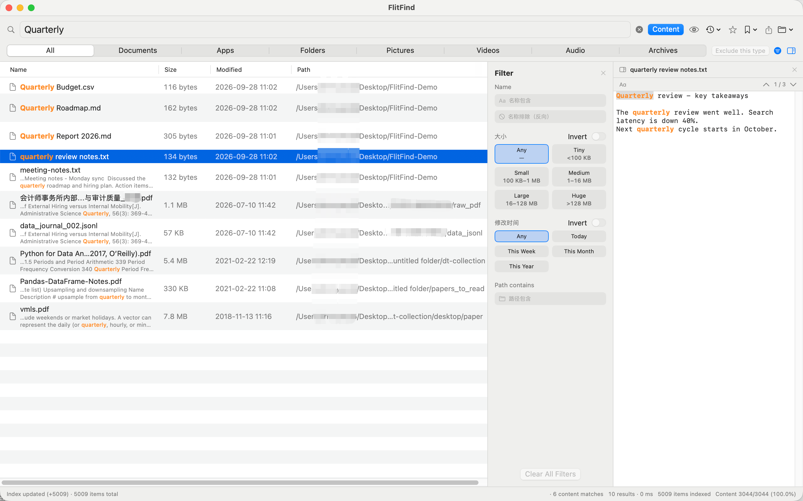

# FlitFind — macOS 闪电文件 · 全文搜索

**输入即中,快如闪电。** 不止搜文件名,更能搜进文件内容:PDF、Word、Excel、PPT、WPS 等 100+ 格式的正文一起搜。

[English](README.md) · 简体中文

## ✨ 特性

- ⚡ **即输即搜** — 索引常驻内存,结果随输入实时刷新,不按回车、不等转圈
- 📄 **全文检索** — 搜进文档正文,不止文件名
- 🎯 **精准过滤** — 通配符、正则、布尔组合,按扩展名 / 大小 / 时间筛选
- 🇨🇳 **拼音直达** — 全拼 / 首字母直击中文文件名
- 🔄 **实时增量** — 文件增删改即时更新索引,永不重建
- 🧰 **实用工具** — QuickLook 预览、命中高亮、重复文件查找、CSV 导出、全局热键(⌥Space)、开机启动

## 📂 支持的内容格式

PDF · Word(doc/docx)· Excel(xls/xlsx)· PowerPoint(ppt/pptx)· WPS · RTF · OpenDocument(odt/ods/odp)· Markdown/纯文本 · 代码与配置(100+ 扩展名:Swift、Python、Java、JS、HTML、JSON、YAML、CSV、日志…)

## 🔒 隐私优先

纯本地索引:无网络权限,不收集、不上传,你的文件只属于你。出于 App Store 沙盒要求,FlitFind 只索引你显式授权的文件夹(可多个,重启后保持授权)。

## 🚀 快速上手

1. 打开 FlitFind
2. 点文件夹图标 → **添加文件夹…**,选择要搜索的目录
3. 直接输入 — 结果毫秒即中
4. 打开 **「搜索文件内容」** 开关,连正文一起搜

## 💬 支持

问题反馈与功能建议:**peterzhaochenyang@gmail.com**

---

📖 <a href="README.md">English</a>

